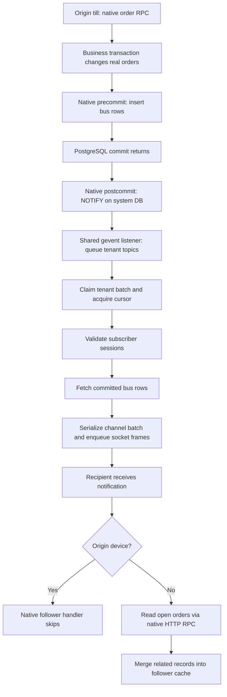

# Odoo POS Bus investigation

**The strongest finding is POS-generated read amplification, not a demonstrated failure of WebSocket delivery.** In the 100-database native run, all 1,920 expected POS synchronization deliveries arrived (p99 **82.76 ms after commit**), but 13 follower HTTP reads failed and average follower-request time reached **8.55 seconds**. A diagnostic emulator variant that suppressed equal duplicate refresh callbacks halved the reads, while leaving the server and all Bus messages unchanged; its mean follower-request time was **0.52 seconds**, with no HTTP errors.

There are two concrete POS code issues:

1. `pos_self_order` publishes a second identical synchronization notification after base POS already published one—even when self ordering is disabled. Each other till consequently reads twice.
2. The follower query advances its cached `write_date` by one second. A second edit within that second can be excluded from the refresh query despite successful notification delivery. The browser-free correctness test reproduced stale quantity/preparation state.

Bus also has real shared limits: its gevent process, tenant cursor pool, authenticated session checking, database fetches, and per-socket outgoing queues. A cold connection burst reproduced gevent pool exhaustion. **The tested warm workloads did not establish Bus's maximum capacity or reproduce a sustained Bus-only clog.** They show why transport delay, application refresh delay, and startup resource failures need separate measurements.

The two code findings are detailed below with exact source lines. This report investigates what limits the existing system; it does not propose replacing Bus.

## Scope and experimental setup

Source is upstream Odoo master commit
`5bcf314eb0896bdf7e218341a134901004ba3d4d`, read without patches. The experiment
uses isolated `posbus_` databases, its own processes/ports/data directory, and
the [probe addon](/home/coder/worktrees/justpickles00/custom-odoo-addons/master-pos-bus-investigation/pos_bus_probe/README.md).
No other Odoo deployment was active or modified. No browser was started.

The VM has approximately 10 GB RAM. It runs 20 prefork HTTP workers, one gevent
websocket process and one cron worker against the shared local PostgreSQL
cluster. Every tenant database is cloned from a template with POS and restaurant/
self-order modules installed. Only 20% of tenants have active POS tills in the
main workload; all tenants have background authenticated subscribers. This is
an activity split, not a claim that the other databases lack POS modules.

The installed-module provenance matters because this is not a standalone,
base-POS-only benchmark:

| Relevant installed module | Role in this experiment |
| --- | --- |
| `point_of_sale` | Native originating order methods and follower open-order reads. |
| `pos_restaurant` | Restaurant/preparation workflow used by active tenants. |
| `pos_self_order` | Automatically installed with the restaurant module; its Python overrides execute even with the fixture's self-ordering mode set to `nothing` (disabled). No self-order application client participates. |
| `web`, `bus`, `pos_bus_probe` | Native authentication/transport plus opt-in measurement and canary endpoints. |

The [fixture manifest](/home/coder/playground/pos-bus-investigation/fixture.json)
records the concrete configuration/session/user/product IDs used by the
clients; [fixture construction](/home/coder/worktrees/justpickles00/custom-odoo-addons/master-pos-bus-investigation/scripts/pos_bus/fixture.py)
and [database provisioning](/home/coder/worktrees/justpickles00/custom-odoo-addons/master-pos-bus-investigation/scripts/pos_bus/provision.py)
record how that template and its tenant clones were produced. The producer
audit verifies the three relevant POS modules' installed state and disabled
self-order configuration. The 20% activity fraction does not remove the
self-order override from the other cloned databases.

For the completed 20-tenant run, four active restaurant tenants had four tills
each, and all 20 tenants had two background subscribers: **16 tills + 40
background sockets = 56 connections**. Background sockets subscribed to a
separate canary channel, not the POS configuration channel. The workload offered
0.0125 complete lifecycles per second per active till, spread across tenants and
tills. A lifecycle comprised create, edit, preparation, and payment or
cancellation, with a 1.2-second step delay. Startup was paced one device at a
time; subscription barriers preceded and followed the measurement.

The later bounded configuration uses one preloaded fixture database, registry
LRU size 2, HTTP pool size 3 per worker, gevent pool size 16, HTTP soft memory
limit 384 MiB and gevent soft limit 1 GiB. Cron scans only `posbus_0000`, whose
jobs are idle; the template's 24 initially active cron jobs were disabled before
cloning. These tighter process-memory limits address the VM's memory envelope and differ
from the completed 20-tenant run's 2 GiB HTTP soft limit. Comparisons must retain
that configuration difference.

## The path being measured



The primary latency clock starts immediately after the real low-level
PostgreSQL connection commit returns and ends when the recipient socket reads
the notification. It includes postcommit NOTIFY, listener/queue delay, dispatch,
and local transport. It excludes the business RPC work before commit and the
follower's later reread/cache update. A quick notification is therefore not a
measurement of complete POS convergence.

Committed bus IDs are mapped to their tenant and originating operation, then
joined to client receipts. Per-row channel/type/size metadata permits checking
rows that no recipient observed. IDs must be joined by `(database, bus_id)`;
cloned tenant databases can contain the same numeric IDs. The probe preserves
native payloads and methods, uses buffered per-process JSONL, and reports
recorder drops. Dispatch-stage spans are overlapping elapsed wall time, not
CPU time. Serialization and enqueue are subsets of dispatch and must not be
added to it as independent costs.

## Application findings

### Two publications produce two follower reads

The [producer audit](/home/coder/worktrees/justpickles00/custom-odoo-addons/master-pos-bus-investigation/docs/pos-bus-code-findings.md)
matches persisted native rows to real order RPCs. For this installed module
combination, one single-order sync/cancellation produces two identical
`SYNCHRONISATION` payloads with different bus IDs, plus one `ORDER_STATE_CHANGED`
message. This occurs even though the fixture's self-ordering mode is disabled.

The base POS implementation [publishes here](/home/coder/worktrees/justpickles00/odoo/master/addons/point_of_sale/models/pos_order.py:921):

```python
for order in pos_order_ids:
    order._ensure_access_token()
    if not self.env.context.get('preparation'):
        order.config_id.notify_synchronisation(order.config_id.current_session_id.id, self.env.context.get('device_identifier', 0))
```

The self-order override [publishes again after the base call](/home/coder/worktrees/justpickles00/odoo/master/addons/pos_self_order/models/pos_order.py:34):

```python
@api.model
def sync_from_ui(self, orders):
    result = super().sync_from_ui(orders)
    order_ids = self.browse([order['id'] for order in result['pos.order'] if order.get('id')])
    self._send_notification(order_ids)
    return result
```

Its [helper](/home/coder/worktrees/justpickles00/odoo/master/addons/pos_self_order/models/pos_order.py:51)
has no self-order-mode check:

```python
def _send_notification(self, order_ids):
    config_ids = order_ids.config_id
    for config in config_ids:
        config.notify_synchronisation(config.current_session_id.id, self.env.context.get('device_identifier', 0))
        config._notify('ORDER_STATE_CHANGED', {})
```

Native follower callbacks do not coalesce these two distinct rows. The sender
receives both but skips its own reread; every other interested till reads twice.
At four tills, this means `2 × (4 − 1) = 6` follower reads per originating step.
The completed run observed exactly `96 × 6 = 576`. This is avoidable
application-level read amplification demonstrated in this module combination,
not duplicate delivery of the same Bus row. No producer or client behavior was
changed for the native baseline.

### Receipt does not guarantee a fresh follower cache

The [cache timing audit](/home/coder/worktrees/justpickles00/custom-odoo-addons/master-pos-bus-investigation/docs/pos-bus-cache-findings.md)
separates transport receipts from query/cache results. The native client
[advances cached write timestamps by one second](/home/coder/worktrees/justpickles00/odoo/master/addons/point_of_sale/static/src/app/utils/devices_synchronisation.js:203):

```javascript
const recordDateTime = record.write_date.plus({ seconds: 1 }).toUTC();
const recordDateTimeString = recordDateTime.toFormat("yyyy-MM-dd HH:mm:ss", {
    numberingSystem: "latn",
});

let domain = new Domain([
    ["id", "=", record.id],
    ["write_date", ">=", recordDateTimeString],
]);

if (model === "pos.order") {
    domain = Domain.or([
        domain,
        new Domain([
            ["id", "=", record.id],
            ["state", "!=", record.state],
        ]),
    ]);
}
```

A same-second change with unchanged state can be excluded by that predicate.
Two slower smokes passed eight peer-cache checks each. A fast smoke with a
0.01-second step delay completed its notifications and 16 follower reads but
failed two of eight intermediate peer checks at approximately 0.409 seconds:
one stale edited quantity, and one missing preparation graph. This is a
reproduced emulator-state result consistent with the source predicate; actual
browser/DOM behavior and the full cache-merge causal chain remain unverified.

## Measured runs

All runs used real tenant databases and zero browsers. The standard actor mix was four tills in each active restaurant database (20% of the fleet), plus two background subscribers per database. Synchronization latency below includes all order operations offered during the window and their bounded drain. Startup/final barrier canaries are excluded from the monitoring-canary quantiles.

| Native run | Sockets / active restaurants | Offered window | Completed orders / steps | Expected and received sync deliveries | Sync p99 after commit | Monitoring canary p99 | Follower reads attempted / errors |
| --- | --- | --- | --- | --- | --- | --- | --- |
| 20 databases, initial configuration | 56 / 4 | 120 s | 24 / 96 | 768 / 768 | 14.49 ms | 18.06 ms | 576 / 0 |
| 50 databases, bounded configuration | 140 / 10 | 60 s | 30 / 120 | 960 / 960 | 26.64 ms | 32.26 ms | 720 / 0 |
| 100 databases, bounded configuration | 280 / 20 | 60 s | 60 / 240 | 1,920 / 1,920 | 82.76 ms | 61.56 ms | 1,440 / 13 |

The 100-database workload completed its last order **107.93 seconds after the scheduled start**, although arrivals were offered over 60 seconds. It accumulated application work; it was not a successful 60-second steady-state capacity demonstration. All 60 orders were independently checked in PostgreSQL: 20 paid and 40 cancelled, each with the expected lines, taxes and preparation records. Payment amounts were checked for paid orders. The 13 errors were HTTP 408 responses on `read_config_open_orders`; they were not missing Bus deliveries.

The initial 20-database row used the larger HTTP memory limit; use the bounded repeat/control data below for comparisons under identical settings. The host, generator, PostgreSQL and all Odoo processes shared this VM. The native 100-database run also recorded two >50 ms generator event-loop stalls during load (maximum 111.82 ms), so its receipt tail is not a pure measurement of server execution time.

### Equal-callback control: same Bus traffic, half the follower reads

The counterfactual changes notification consumption in the emulator: within a single received WebSocket frame, a second identical synchronization type/payload does not invoke the follower callback again. Every raw notification is still received and recorded. The production source and probe publisher are unchanged. This is a diagnostic control, not a proposed or deployed fix.

| 100-database measurement | Native callbacks | Equal callbacks coalesced |
| --- | --- | --- |
| Real orders / native order steps | 60 / 240 | 60 / 240 |
| All received notifications, including canaries | 3,998 | 3,998 |
| POS synchronization deliveries | 1,920 | 1,920 |
| Follower read attempts | 1,440 | 720 |
| Follower HTTP errors | 13 | 0 |
| Mean follower-request duration, including failed attempts | 8,546.60 ms | 516.64 ms |
| POS notification commit-to-receipt p99 | 82.76 ms | 48.26 ms |
| Last order completion after scheduled start | 107.93 s | 64.53 s |

Startup concurrency also differed: one device at a time in the native 100-database run, two in the coalesced run. This was one sequential pair, not a randomized, repeated one-factor latency comparison.

The halving of reads follows directly from the duplicate publications and is verified in the traces. The latency difference is an observed result of this pair, not a portable speedup estimate: execution order, worker recycling/cache state, startup pacing and shared-VM scheduling are additional influences. Nevertheless, the unchanged transport work and reduced application reads are useful evidence of how feature behavior can overload resources shared with Bus.

### Bounded 20-database controls

Both used 56 sockets, 12 real orders, 48 order steps and the same bounded server settings/startup concurrency of two. Every expected sync delivery arrived (384 in each run), with no HTTP errors.

| Receiving behavior | Follower reads | Sync delivery p99 | Monitoring canary p99 |
| --- | --- | --- | --- |
| Passive, record notifications only | 0 | 12.15 ms | 20.77 ms |
| Native follower repeat | 288 | 14.16 ms | 17.02 ms |

This smaller workload did not show the severe refresh backlog seen at 100 databases. The non-monotonic canary results also caution against attributing small timing differences to a single factor.

### Where Bus spent elapsed time

The probe separates cursor acquisition, session validation, fetching, and dispatch. These are elapsed wall times, not CPU profiles; nested serialization/enqueue counters must not be added again to dispatch. Only batches containing commits inside the scheduled measurement window enter these stage statistics; delivery completeness also covers drain.

For 306 selected batches in the native 100-database run, mean elapsed cursor acquisition was 7.70 ms, session validation 9.19 ms, fetching 2.28 ms and dispatch 0.26 ms. Mean serialization (0.042 ms) and enqueue (0.164 ms) are included within dispatch. Mean queue wait was 0.214 ms. These measurements do not identify a CPU bottleneck.

Stage statistics and per-tenant quantiles are in each run's `analysis.json`. In the large native run, connection acquisition and authenticated session checks took substantially longer than serialization/enqueue. The report therefore identifies their source as scaling-sensitive paths, without claiming a precise production saturation threshold. A delayed follower HTTP read cannot be attributed to Bus merely because a Bus notification triggered it.

## Shared costs and observed failures

The [native dispatcher](/home/coder/worktrees/justpickles00/odoo/master/addons/bus/bus_dispatcher.py:369)
processes a tenant batch in this order:

```python
with acquire_cursor(dbname) as cr:
    self._kick_invalid_sessions(cr, topics)
    notifications_by_channel = self._fetch(cr, topics)
self._dispatch(topics, notifications_by_channel)
```

Authenticated subscribers add real validation work. The
[session checker](/home/coder/worktrees/justpickles00/odoo/master/addons/bus/session_helpers.py:78)
opens each distinct subscriber session file for revalidation; its inode/mtime
cache can avoid rereading unchanged file contents, but not that open/fstat.
It then [checks user session-token data in SQL](/home/coder/worktrees/justpickles00/odoo/master/addons/bus/session_helpers.py:100),
grouped for the batch. This is required security work in the current design,
not evidence that inactive POS databases publish order traffic.

The [dispatch pool sizing](/home/coder/worktrees/justpickles00/odoo/master/addons/bus/bus_dispatcher.py:292)
uses the gevent cursor budget; with 16 connections and the default 30% reserve,
it starts ten dispatch workers after reserving five plus the listener's one.
That reserve is not a separately enforced pool partition. Native
[ConnectionPool.borrow](/home/coder/worktrees/justpickles00/odoo/master/odoo/sql_db.py:662)
is locked, including new connection creation; many tenant DSNs compete for a
bounded cache of connections. A full pool with no free connection raises
immediately. Cold registry setup and transaction cleanup can require additional
registry/cursor work. These are concrete shared scaling costs and startup
constraints; the report does not assume each is already a steady-state
bottleneck.

| Attempt | Observed outcome | Interpretation |
| --- | --- | --- |
| Eager preload of 100 databases; LRU 8, 512 MiB HTTP soft limit | Workers exceeded soft memory before handling requests; host OOM killed the experiment parent. | Invalid startup configuration for this VM, before a Bus workload. |
| Cold 20-tenant startup; LRU 2, gevent pool 16, startup concurrency 12 | HTTP 500 websocket handshakes from local connection-pool exhaustion amid registry churn. | Cold startup contention; no order workload reached its measurement window. |
| First 50-tenant paced attempt under the larger HTTP memory limits | Host memory guard stopped the experiment below its 1200 MiB availability threshold. | Interrupted capacity window; errors/disconnects after the intentional stop cannot be attributed to Bus saturation. |

The [startup findings](/home/coder/worktrees/justpickles00/custom-odoo-addons/master-pos-bus-investigation/docs/pos-bus-startup-findings.md)
contain exact evidence and source paths for the first two failures. The
[guard log](/home/coder/playground/pos-bus-investigation/results/guard.log)
records the third stop. The subsequent bounded 100-tenant attempt reduces HTTP
memory limits and keeps gevent separately bounded; the completed outcomes above retain those configuration differences. No capacity number is inferred from an interrupted run.

The bounded 50/100-database runs completed their connection and delivery phases. The native 100-database run had application-read errors, which remain visible in its results. Passive-follower and bounded native-repeat controls are recorded alongside the main runs; their exact metrics are in the [evidence index](pos-bus-results/README.md). No interrupted run is counted as a passing capacity result.

## Evidence categories and limits

| Category | Established here |
| --- | --- |
| Measured problem | Two producer invalidations and two follower reads per other till; two fast-smoke intermediate emulator cache failures; startup memory/pool failures under their specific configurations. |
| Required current scaling cost | Durable bus rows/commit/NOTIFY, per-tenant fetches, authenticated session checks, bounded cursor sharing, one socket delivery per interested recipient, and native follower rereads. |
| Untested or unresolved | Full 2,000-tenant deployment capacity, production traffic distributions, WAN/mobile latency, browser rendering/IndexedDB behavior, real kitchen display/self-order clients, slow consumers/reconnect storms, long-running retention/vacuum effects, and which stage first saturates after successful warm startup. |

The emulator uses real authenticated native RPCs, persisted order/preparation/
payment records, ordinary Bus subscriptions and native follow-up reads. It
models a bounded subset of client domains, related-record loading and caches;
it does not execute the full frontend. Correctness smokes cover selected
create/edit/preparation/payment/cancellation paths, not all POS workflows. The
main 20-tenant performance run did not enable per-step peer-cache assertions;
its successful delivery and completed follower reads must not be described as
proof of every intermediate cache state.

All processes and the load generator share one VM, and receipt latency uses
loopback rather than a production network. Instrumentation adds clocks,
bookkeeping and per-row metadata parsing; buffered recording avoids per-event
synchronous disk writes but does not eliminate perturbation. A
`POS_BUS_PROBE_STAGES=0` control removes dispatch-stage hooks while retaining
commit/RPC metadata, so it measures only that part of instrumentation overhead.
Elapsed spans cannot be converted into CPU cost without independent resource
measurements.

The runtime [results directory](/home/coder/playground/pos-bus-investigation/results)
contains client event streams, summaries, resource samples and analysis JSON;
the [probe directory](/home/coder/playground/pos-bus-investigation/probe)
contains cumulative per-process server traces. Reproducible source and scripts
are in this worktree. Selected summaries and compressed raw traces are bundled with this worktree (see the [evidence index](pos-bus-results/README.md)). The conclusion is limited to the measured workloads: duplicate POS invalidations amplify application reads; the timestamp filter can miss rapid edits; cold multi-tenant startup can exhaust shared gevent resources; the completed delivery runs do not establish an intrinsic WebSocket/Bus ceiling.


### Fidelity boundaries

These are targeted, stateful diagnostic journeys, not a calibrated restaurant traffic model. Orders remain open for a few seconds between scripted steps; the experiment does not reproduce an evening of long-lived occupied tables, large baskets, courses, complex merges, physical printing, payment terminals, or Enterprise kitchen displays. All databases have the POS modules installed even when their tills are inactive. The small registry LRU and memory limits are lab constraints, not recommended production settings.

The short deterministic cancellation schedule yielded 16 paid / 8 cancelled orders in the initial 120-second run, and one-third paid / two-thirds cancelled in the 60-second fleet windows. This differs from the nominal cancellation threshold in the generator; the measured counts, not that nominal parameter, describe these runs. The native/coalesced pair used the same schedule. Do not extrapolate restaurant orders/hour from this workload.

The emulator does not automatically reconnect failed sockets, execute the actual browser worker or render the POS UI. It implements the inspected protocol and selected receiving logic; follower concurrency is bounded and saturation is recorded. No slow-reader, reconnect-storm, 2,000-database, or instrumentation-disabled capacity result is claimed. Customer displays and self-order clients can add further traffic but were not included in the measured actor mix.

All six completed fleet runs passed independent persisted-order checks and exact notification recipient-set checks, with zero unmatched receipts and zero reported recorder drops. Six probe semantic tests and Python compilation passed. The isolated server was stopped after measurement; upstream Odoo and the original SSE worktree remain unchanged.

## Customer display clarification

In this master revision the normal customer-display update travels through the deployed server, even when the display shares a browser/origin. The [terminal plugin](/home/coder/worktrees/justpickles00/odoo/master/addons/point_of_sale/static/src/app/plugins/customer_display_terminal_plugin.js:134) first calls `pos.config.update_customer_display`; its `catch` path uses `BroadcastChannel` as a local fallback. No connected display means no update RPC. The [server method](/home/coder/worktrees/justpickles00/odoo/master/addons/point_of_sale/models/pos_config.py:1135) publishes via `_notify` and native Bus. Display traffic is therefore a possible additional contributor, but this experiment did not include connected customer displays and cannot quantify its impact.

## Further Bus limits visible in source

The native [notification query](/home/coder/worktrees/justpickles00/odoo/master/addons/bus/tools/notifications.py:42) retrieves matching rows with `fetchall()` and no `LIMIT`. A large retained backlog can therefore increase fetch/materialization/serialization work in a batch. Each socket has a [1,024-command outgoing queue](/home/coder/worktrees/justpickles00/odoo/master/addons/bus/websocket.py:190); [queue saturation closes the socket](/home/coder/worktrees/justpickles00/odoo/master/addons/bus/websocket.py:296). Commands are not a byte budget. These are inspected capacity mechanisms, not failures observed during the completed warm runs.

Thus the anecdote is plausible through several distinct mechanisms: cold multi-tenant connection churn, a slow/overloaded PostgreSQL path, heavy authenticated fan-out, large backlogs, or slow consumers. The duplicate POS invalidations additionally cause HTTP rereads, which compete for shared CPU/database resources even with twenty HTTP workers. The number of tenant databases alone cannot determine the limit; active subscriptions, sessions, recipient count, event rate and payload/backlog size matter.

## Next experiment if a saturation threshold is needed

Retain browser-free native clients and real order checks. First repeat the native/coalesced pair with identical startup pacing, randomized order and several repetitions. Separate the generator from the Odoo/PostgreSQL host and quantify probe overhead. Then hold order rate fixed while varying active tenants and tills per restaurant; separately hold recipients fixed while ramping order-event rate. Run long enough to distinguish accumulating work from a stable queue, recording both notification receipt and follower convergence.

Use passive recipients to isolate transport work, plus unrelated-tenant canaries to detect shared impact. In distinct runs add slow socket readers, reconnect bursts and retained-history catchup; observe queue closures, cursor failures and fetch batch sizes. Add customer-display or self-order actors only after reproducing their real RPC/subscription behavior. Do not substitute arbitrary giant Bus messages for a POS workflow when claiming POS capacity. Warm-capacity runs and cold-start tests must remain separate. No new notification-system decision is required to perform these measurements.
