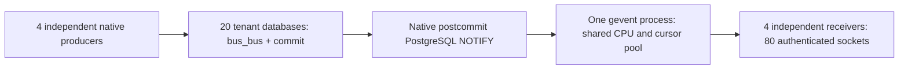

# POS/Bus load follow-up

The [real restaurant follow-up](pos-bus-realistic-load.md) separates actual POS workload limits from the heavy synthetic Bus result below.

This extends the [first investigation](pos-bus-investigation.md). It tests the
limits of Odoo's existing Bus, using zero browsers and unchanged upstream source
at `5bcf314eb0896bdf7e218341a134901004ba3d4d`. All writes belong to the isolated
`posbus_` laboratory. Native real-order traffic and controlled Bus traffic are
separate experiments; controlled notifications do not represent real orders.

**This follow-up reproduced sustained Bus delivery congestion.** At an achieved
input of approximately 33,000–34,000 committed rows/second, one gevent process
used 96–97% of one CPU core, and notification receipt averaged about 5 seconds.
The receiving emulators were split across four processes. Server-side evidence
places 4.83 seconds of mean delay before dispatcher batch completion, so this
was not merely the receiving emulator falling behind. The congestion persisted
with dispatcher instrumentation disabled.

This is a congested operating point in this particular high-rate, batched lab
workload, not Odoo's universal capacity ceiling or a reproduction of the precise
2,000-tenant restaurant anecdote. The real-order workload separately overloaded
application processing while its measured notification deliveries remained fast.

## Decisive delivery result

Both runs used 20 active databases, four authenticated recipients per database,
four independent producer/receiver cohorts and 60 seconds of offered load.
The offered rate was 40,000 rows/second, in native transactions containing 1,000
rows. The actual input was lower because producer queues were bounded; missed
admissions were counted and never silently retried.
Both runs drained all committed deliveries, but each cohort process exited with
status 1 because some offered work was rejected. These are valid congestion
measurements, not passing acceptance tests at the offered rate.

| Measurement | Dispatcher tracing enabled | Dispatcher tracing disabled |
| --- | ---: | ---: |
| Committed rows/s inside offered window | 33,933 | 33,050 |
| Committed rows, including producer drain | 2,104,000 | 2,050,000 |
| Offered rows rejected before publication | 296,000 | 350,000 |
| Expected / received recipient deliveries | 8,416,000 / 8,416,000 | 8,200,000 / 8,200,000 |
| Mean commit-to-receipt delay | 5.07 s | 4.95 s |
| Maximum commit-to-receipt delay | 13.04 s | 15.45 s |
| Last receipt after offered window ended | 7.83 s | 7.12 s |
| Peak outstanding deliveries at one-second samples | 1,180,000 | 1,192,000 |
| Mean gevent CPU, percentage of one core | 97.2% | 96.3% |

Receivers averaged about 44% of one core each; producers averaged about 53% each.
The clients still experienced burst-related event-loop stalls, up to 1.73 seconds
in the traced run, so end-to-end receipt delay is not pure server execution time.
The independent server join resolves this attribution: all 2,104,000 committed
rows matched their native dispatch batch, with commit-to-batch-completion mean
**4.83 seconds**, p99 **10.91 seconds**, maximum **12.42 seconds**. There were no
unmatched rows, repeated matching fetches, rollback batches or reported recorder
drops. Batch completion is after enqueue/history work and claim release; it is
not a measurement of the actual socket write.

The traced run's 807 matching dispatch batches averaged 1,129 ms in the fetch
wrapper, 94 ms in session validation, 45 ms acquiring a cursor, and 16 ms in dispatch.
These spans include cooperative scheduling and overlap across tasks; they do
not prove that PostgreSQL execution alone consumed 1,129 ms or that fetch consumed
that much CPU. Together with gevent CPU and the probe-disabled repeat, they
identify the shared fetch/dispatch path as a real limit worth profiling further.
No socket-queue saturation or event loss was observed in these completed runs.

The earlier single-process ramp was insufficient: at target 20,000/s its producer
and receiver each used about 93–94% of a core, while gevent used 69%. That run's
latency could not establish a gevent ceiling. The sharded runs above specifically
address that emulator bottleneck. They are one sequential diagnostic pair;
different achieved rates, cached data and execution order preclude a precise
instrumentation-overhead or portable-throughput estimate.

## Real restaurant workload result

During the 180-second window, 2,880 table actions were scheduled,589 completed,
227 were rejected by the bounded queues, and 2,064 remained queued or active at
the end. The achieved rate was 3.27 actions/s against16 scheduled/s. The remaining
work did not drain within 120 seconds, so this run exited unsuccessfully and did
not reach its planned payment/cancellation finalization.

All 4,712 synchronization deliveries originating from commits inside the measured
window arrived at their exact intended recipients. Their mean delay was 32 ms,
p99 **76 ms**, maximum192 ms. All 2,356 order-state and 658 monitoring-canary
deliveries from that window also arrived. Thus this run showed application work
accumulating without comparable Bus delay.

A read-only reconciliation verified all 32 persisted draft orders, their UUIDs,
tables, two real lines each, quantities, prices, totals and tax arithmetic.
It does not claim that abandoned actions ran, that those orders were paid, or
that every peer cache converged. A separate short smoke completed real payment/
cancellation and preparation verification for four orders. The laboratory's
384 MiB HTTP virtual-memory limit caused frequent worker recycling; the 3.27/s
figure is therefore not a POS production-capacity estimate or proof that POS
code alone caused the application bottleneck.

## Measured cost of the history exclusion query

A separate read-only diagnostic, after stopping the load, compared the native
query's old lower bound plus historical `NOT IN` IDs with an advanced-bound
query returning the same latest 1,000 rows. All comparisons ran in one read-only,
repeatable-read snapshot; all returned IDs matched. Three measured alternating
pairs followed warmup at each size.

| Excluded history IDs | Native SQL size | Mean native parameter adaptation | Mean native total: adaptation + execute + fetch | Advanced-bound total |
| --- | ---: | ---: | ---: | ---: |
| 1,000 | 8.2 KB | 0.77 ms | 6.56 ms | 3.58 ms |
| 10,000 | 80.2 KB | 10.71 ms | 42.79 ms | 3.46 ms |
| 30,000 | 240.2 KB | 15.67 ms | 80.09 ms | 3.71 ms |

The query is adapted once before execution; the adaptation column is already
included in the total and must not be added again. At 30,000 exclusions, EXPLAIN reported mean planning
24.77 ms and execution 21.39 ms, versus 0.39 ms and 0.64 ms for the advanced-bound
variant. This establishes a concrete cost in the inspected exclusion-query
design. It does not establish how much of the concurrent run's latency belongs
to that one mechanism. Advancing the bound would lose the native protection
against out-of-order commits; this counterfactual is not a proposed patch.

The actionable source locations are
[history/exclusion construction](/home/coder/worktrees/justpickles00/odoo/master/addons/bus/bus_dispatcher.py:171),
[the expanded NOT IN query and fetchall](/home/coder/worktrees/justpickles00/odoo/master/addons/bus/tools/notifications.py:49),
and [the second exclusion/history pass after fetch](/home/coder/worktrees/justpickles00/odoo/master/addons/bus/bus_dispatcher.py:232).

## What the database-connection budget means

`db_maxconn_gevent` limits the physical PostgreSQL connections in the gevent
process's pool, including idle cached connections, across all databases. It is
not the number of WebSockets, users or tenants. An established socket does not
permanently reserve its own database connection. Each HTTP process has its own
pool, and PostgreSQL additionally imposes its server-wide connection limit.

The first experiment explicitly set gevent's pool to 16. Native master defaults
to `db_maxconn=64`, with gevent inheriting it unless separately configured.
The cold-start follow-up tried 64 with 20 HTTP processes at 3 each. It hit
PostgreSQL's global 100-connection limit: server logs contain `remaining
connection slots are reserved for roles with the SUPERUSER attribute`, with
failed WebSocket handshakes including404 responses from an unusable registry.
This is different from Odoo's process-local `PoolError` in the original test.

The subsequent laboratory budget is 20 HTTP processes× 2 plus gevent 40, with
headroom for cron, monitoring and bounded producers. One producer process with
P worker threads needs up to 2P+1 connections here: a tenant transaction per
worker, the native postcommit connection to the system database, and the outer
Odoo shell cursor. Four independent one-worker producers budget 12 total.
PostgreSQL settings were not changed. These settings fit this shared cluster;
they are not production-sizing recommendations.

The native dispatcher reserves 30% in its worker-count calculation plus one
persistent listener connection. Gevent 40 therefore starts27 dispatch tasks.
The reservation is not an enforced private pool partition. Cold registry
initialization and incoming requests can compete with dispatch for connections.

## What changed in the simulation

The original 100-database run offered only one new order per second overall,
used four short steps per order, and let HTTP responses pace subsequent steps.
It could expose POS refresh amplification but could not establish Bus capacity.

The new independent [ramp](../scripts/pos_bus/bus_ramp.py) keeps authenticated
native WebSockets subscribed, warms every database with a positive canary, and
publishes via native `_sendone`, native precommit row creation and normal
commit/postcommit NOTIFY. The master revision has no `_sendmany` method.
Its synthetic payload has the small POS synchronization structure plus a trace
marker; it does not mutate orders. Native persisted IDs and low-level commit
return times are joined to exact recipient identities. Events per second,
transactions per second, events per transaction and recipient deliveries are
reported separately. Queue admission misses remain visible.

The [cohort runner](../scripts/pos_bus/cohort_ramp.py) divides 20 databases into
four disjoint groups of five, each with an independent producer and receiving
process. A shared gate opens only after all recipients have received warmup
canaries. This spreads generator and receiver CPU across cores while preserving
the single shared gevent process. Each cohort verifies all four intended
recipients of each of its committed events; there is no sampled recipient matrix.

The [restaurant profile](../scripts/pos_bus/restaurant_load.py) opens 32 real
orders across four restaurant databases, with four tills and two tables per
till. It schedules repeated edits and preparation changes for 180 seconds,
records actual progress and bounded backlog, and normally finalizes through
native payment/cancellation. Opening tables is serialized within each database
outside the measured window, after simultaneous setup exhausted retries on the
POS no-gap order-reference sequence. Measured till activity remains concurrent.

## Measurement safeguards and limitations

- All hosts here are processes on one 12-vCPU, approximately 10 GB VM. There is no
  WAN, browser JavaScript, DOM, IndexedDB or physical payment/printer IO.
- A single Python producer or receiver can saturate before Odoo. Their CPU and
  event-loop delay are measured; a requested input rate is never substituted
  for the achieved commit rate.
- Batching reduces NOTIFY and socket-command frequency. Results with 500 ms
  batches do not establish the same capacity for one-event transactions.
- Overload in the initial ramp favored early databases because bounded queues
  were filled in ascending tenant order. Later code rotates that order. The
  earlier overloaded cases are not balanced 20-tenant capacity results.
- The probe's buffered writer is cooperative in gevent; encoding/writing can
  delay the hub. A stages-disabled repeat is required before attributing a
  high-rate limit to Odoo rather than this instrumentation.
- Stage durations overlap and include scheduling/waiting. They are not CPU
  profiles. Process sampling misses short-lived PostgreSQL backends.
- Cases retain earlier Bus rows. Native retention is 24hours; the dispatcher's
  ten-second history is an ordering/deduplication safety window, not row expiry.
- The restaurant run's first live interval-counter implementation incorrectly
  accumulated its previous Counter, causing negative display deltas. Raw
  timestamped events and backlog samples are intact; reported rates are
  reconstructed from those events. The counter implementation is corrected.

## Inspected paths that can limit delivery

The [pool borrower](/home/coder/worktrees/justpickles00/odoo/master/odoo/sql_db.py:662)
holds its lock during connection establishment. A producer cycling 20 tenants
through nine cached connections can incur connection churn and lock waiting.
The [native postcommit notification](/home/coder/worktrees/justpickles00/odoo/master/addons/bus/models/bus.py:153)
also opens a system-database cursor. This can limit publishers independently of
socket delivery.

For warm dispatch, [session query caching](/home/coder/worktrees/justpickles00/odoo/master/addons/bus/session_helpers.py:38)
usually avoids full registry construction. Session checking still opens session
files and checks token data. The number of subscribed sessions matters, not just
the number of installed tenant databases.

The dispatcher [builds exclusion sets from recent IDs](/home/coder/worktrees/justpickles00/odoo/master/addons/bus/bus_dispatcher.py:171),
and its [query expands those IDs into `NOT IN`](/home/coder/worktrees/justpickles00/odoo/master/addons/bus/tools/notifications.py:49).
The result is fetched without pagination. At high per-channel rates, set
construction, SQL adaptation/planning/filtering and decoding can grow. Old
payloads are normally excluded in SQL, not fetched repeatedly into Python.
The history exists to handle commit ordering correctly; deleting that behavior
would not be a justified optimization based on this experiment.

Each socket has a [1,024-command queue](/home/coder/worktrees/justpickles00/odoo/master/addons/bus/websocket.py:190).
One command can contain many notification rows. A slow reader can fill it and
trigger [native saturation closure](/home/coder/worktrees/justpickles00/odoo/master/addons/bus/websocket.py:296).
The probe observes native close reasons because a full queue may prevent even
the close frame from reaching the recipient. Enqueue timing is distinct from
the actual [socket send](/home/coder/worktrees/justpickles00/odoo/master/addons/bus/websocket.py:474).

## What these findings imply

The anecdote is plausible: a shared gevent process has a real CPU and database
work budget, and active POS features can consume it. This follow-up demonstrates
multi-second server-side congestion under a controlled heavy workload. It does
not show that a normal fraction of 2,000 restaurant tenants necessarily produces
that workload. Event/transaction rate, active channels, sessions, payload size,
recipient fan-out, connection churn and memory limits must be measured in the
actual deployment before assigning its cause.

The strongest concrete feature issue remains the duplicated POS invalidation
identified in the first report. The strongest newly measured Bus code concern
is the growing history-exclusion query and its surrounding shared fetch path.
Further optimization should preserve commit-order correctness and authenticated
session checks. The shared process's CPU saturation also means that adding HTTP
workers alone does not increase its delivery CPU budget.

The [evidence index](pos-bus-results-round2/README.md) links the exact counts,
server-side join, SQL diagnostic, failed-run classifications and compressed raw
traces. Seven probe semantic tests and Python compilation passed. The isolated
server and observers are stopped; the original SSE worktree and upstream Odoo
source remain unchanged. The 32 interrupted-run draft orders are retained for
inspection in the task's fixture databases. No slow-reader/reconnect-storm test
was run, and no universal throughput ceiling or replacement decision is claimed.
